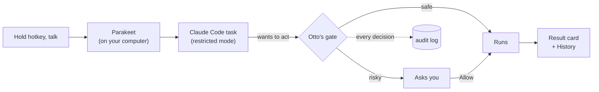

<h1 align="center"> Otto</h1>

<p align="center"><b>Your always-on assistant for the busywork on your Mac (and now Windows).</b></p>
<p align="center">Wispr types what you say. Otto does it.</p>

<p align="center">
  <a href="https://github.com/sacredvoid/otto/releases/latest"></a>
  <a href="https://github.com/sacredvoid/otto/releases/latest"></a>
</p>

<p align="center">
  
</p>

Hold **Ctrl + Option + Space** (**Ctrl + Alt + Space** on Windows), say what you need, let go, and keep working. Otto drips out of the notch while it listens, hands the task to Claude Code, shows progress in a small glass island, and asks before anything risky.

## What it does

| Feature | How it works |
|---|---|
| Hold to talk | A global hotkey. NVIDIA's Parakeet speech model runs on your computer (the GPU on a Mac, the GPU or CPU on Windows), so your audio never leaves it. |
| Background tasks | Up to three tasks at once, each in its own folder under `~/Otto/tasks`. Files a task produces stay there. |
| Permission gate | Every risky action (running a command, writing outside the task folder, sending email, going online after reading your files) waits for an *Allow* click. Each decision is logged to `~/Otto/audit.jsonl`. |
| Your connectors | Uses the Gmail, Google Calendar and other claude.ai connectors your Claude account already has. Read-only calls run on their own. Sending, creating and deleting always ask first. |
| Memory | Otto knows your recent requests, saves lasting facts you mention to a plain-text notes file (`~/Otto/memory.md`) without asking, and can load a memory plugin you already use, such as [claude-mem](https://github.com/thedotmack/claude-mem), so a vague request like "send it to Michael" lands. |
| Mac control | Drives Mail, Messages, Reminders, Notes, Finder and other apps through AppleScript, and can take a screenshot to check its work. Every action is approved by you. |
| Apple Shortcuts | Runs the shortcuts you already have, and builds new ones for you: it writes the shortcut, signs it with `shortcuts sign`, and opens it so you can click *Add Shortcut*. |
| Always there | Opens at login (switch it off from the menu bar), and puts itself away cleanly when your Mac sleeps. |
| History | A window listing everything you've asked, with the answer, the steps taken, the approvals, and the files produced. |

## A look inside

**History** shows every request as a trace: what you said, each step Otto took with its approval, the output, and the result. Follow-ups stay in the same thread.


<table>
  <tr>
    <td width="42%" valign="top"><b>The island</b> sits under the notch while tasks run; hover it for details. Anything risky drops out as a card that waits for <i>Allow</i>, and finished work lands as a short summary.<br><br></td>
    <td width="58%" valign="top"><b>Setup</b> lists everything Otto can use, including the connectors on your Claude account, and lets you switch any of it off.<br><br></td>
  </tr>
</table>

## Things to try

Say these out loud. Anything that sends, changes, or runs something waits for your *Allow*.

**Your day**
- "What's on my calendar tomorrow, and is anything double-booked?"
- "Find the email from Jordan about the offsite and draft a reply saying Friday works."
- "Remind me to call the dentist at 4."

**Your files**
- "Summarize the Q3 planning doc into five bullets I can paste into Slack."
- "Find the PDF invoice from Northwind I downloaded last week and rename it with the date."
- "Turn my notes from this morning into a one-page brief."

**Apple Shortcuts** (on Windows: scheduled tasks and desktop shortcuts)
- "Run my Morning Briefing shortcut."
- "Make me a shortcut that copies the current Safari tab's link as a Markdown link."
- "Build a shortcut that starts a 25 minute focus timer and turns on Do Not Disturb."

**Your Mac**
- "Take a screenshot and tell me what's wrong with this error dialog."
- "Make a new note called Hiring with the three candidates from my last email."

**Things Otto remembers**
- "Priya is my design lead; she prefers short messages." Later: "send Priya the summary."

## How it works



Otto has no model of its own. Each request runs as a `claude -p` task in restricted mode, so your personal allow-rules and hooks are ignored and every permission question comes to Otto's gate. Once a task reads your files or email it's marked tainted, and after that any web access needs your OK too.

## Install

### Mac

1. Install [Claude Code](https://docs.claude.com/claude-code). You sign in from Otto's setup window, and that login stays separate from your Terminal one.
2. [Download Otto](https://github.com/sacredvoid/otto/releases/latest), open the DMG, and drag Otto to Applications.
3. Open Otto. macOS blocks it the first time because it isn't notarized yet. Click **Done** (not Move to Trash), then go to System Settings, Privacy & Security, scroll down, and click **Open Anyway**. Or run this once in Terminal:
   ```bash
   xattr -dr com.apple.quarantine /Applications/Otto.app
   ```
4. The setup window walks you through signing in to Claude, microphone access, which folders Otto may read, and which of your account's connectors it may use.

### Windows (experimental)

1. Install [Git for Windows](https://git-scm.com/download/win) (Claude Code needs its Git Bash), then [Claude Code](https://docs.claude.com/claude-code). The native installer is best: `irm https://claude.ai/install.ps1 | iex` in PowerShell.
2. [Download](https://github.com/sacredvoid/otto/releases/latest) `Otto-<version>-Windows-Setup.exe` and run it. It installs for your user only, no admin needed. SmartScreen may warn because the installer isn't signed yet: click **More info**, then **Run anyway**.
3. Otto appears in the system tray (you may need the **^** overflow arrow). The setup window walks you through the same steps as on a Mac.

What's different on Windows: there's no notch, so the island drops from the top of the screen, and the cards are solid instead of glass. Otto drives apps with PowerShell instead of AppleScript, uses Windows Search to find files, and sets up automations as Scheduled Tasks instead of Shortcuts. It's new, so please [file an issue](https://github.com/sacredvoid/otto/issues) when something's off.

The speech model ships inside the app, so there's nothing else to download. On Windows, Otto uses your graphics card through Vulkan when it beats the CPU, and the CPU otherwise. At launch it times one short run on each and keeps the faster one. A PC without a Vulkan driver runs on the CPU.

**Updates:** Otto checks GitHub once a day. When a new version is out, the menu bar (or tray) menu shows *Update available*, which opens the download page. Turn it off with `"check_updates": false` in `~/Otto/config.json`.

<details>
<summary>Build from source</summary>

Needs Rust and Node 20+.

```bash
git clone https://github.com/sacredvoid/otto.git && cd otto
npm install
npm run tauri dev      # run it
npm run tauri build    # make Otto.app and the DMG (fetches the speech model first)
```

On Windows, also install the [Visual Studio C++ build tools](https://visualstudio.microsoft.com/visual-cpp-build-tools/), CMake and the [Vulkan SDK](https://vulkan.lunarg.com/sdk/home#windows) (for the speech engine), and fetch the models yourself first: `sh scripts/fetch-model.sh` in Git Bash. `npm run tauri build` then makes an NSIS installer.
</details>

## Follow-ups

Start with "no", "actually", "make it…", "try again" and similar within 10 minutes of a task finishing, and Otto continues that task (same folder, same Claude session) instead of starting a new one. The island says "Following up".

## Configuration

Everything lives in `~/Otto/config.json`. Every key is optional.

```jsonc
{
  "readable_dirs": ["~/Documents", "~/Desktop"],          // read without asking
  "plugins": ["claude-mem@thedotmack"],                    // Claude Code plugins to load
  "mcp_servers": { "notion": { "type": "http", "url": "https://..." } },  // extra MCP servers
  "allow_tools": ["mcp__plugin_claude-mem_mcp-search__search"],          // read-only tools that skip the prompt
  "model": "sonnet",                                       // optional: a faster model for quicker answers
  "ask_memory": true,                                      // ask before each memory save (default: automatic)
  "launch_at_login": false,                                // don't open at login (the menu bar toggle sets this)
  "speech_model": "ggml-base.en.bin",                      // optional: another speech model (default: Parakeet 0.6B)
  "speech_device": "cpu"                                   // optional: "auto" (default), "cpu", or part of a GPU name such as "RTX"
}
```

To use a different speech model, put its file in Otto's models folder (`~/Library/Application Support/app.otto.desktop/models/` on a Mac, `%APPDATA%\app.otto.desktop\models\` on Windows) and set `"speech_model"` to its file name. Otto accepts Parakeet and Whisper files in GGUF or ggml format. `ggml-base.en.bin` ([download](https://huggingface.co/ggerganov/whisper.cpp/resolve/main/ggml-base.en.bin)) brings back the Whisper model Otto used before. Restart Otto after you change `"speech_model"` or `"speech_device"`.

To edit what Otto remembers about you, open `~/Otto/memory.md`. It's one fact per line, and Otto adds lines when you tell it something worth keeping.

## Project layout

```
src-tauri/src/
  lib.rs        hotkey, recording, app wiring
  stt.rs        speech-to-text through transcribe.cpp (Parakeet)
  device.rs     picks the GPU or CPU for speech
  vad.rs        Silero voice detection, skips silent taps
  speech_config.rs  speech_model and speech_device settings
  tasks.rs      task queue, claude CLI invocation, system prompt, memory
  gate.rs       MCP server + permission policy + audit log
  history.rs    reads past tasks for the History window
  onboarding.rs first-run setup
  overlay.rs    the notch island and cards windows, native glass
  power.rs      open at login, sleep and wake
  platform.rs   the macOS / Windows differences in starting programs
src/            each window as page + script + styles (pill, cards, setup, history)
scripts/hero.py regenerates docs/hero.svg
DESIGN.md       the design doc and build plan
```

## Roadmap

- [x] Hold-to-talk, local speech, background Claude Code tasks
- [x] Permission gate with taint tracking and audit log
- [x] Notch pill, approval cards, onboarding, History
- [x] Connectors, memory, Mac app control
- [ ] Other AI backends: Codex CLI, Gemini CLI, OpenAI-compatible APIs, Ollama
- [x] Downloadable DMG, built by CI; tagged versions become releases
- [x] Windows build (experimental)
- [ ] Notarized and signed builds with auto-update

## Contributing

Bug reports and pull requests are welcome. See [CONTRIBUTING.md](CONTRIBUTING.md) for setup, tests, and the rules around the permission gate.

## Status

Early preview. I use it daily, it has rough edges. On a Mac it needs Apple Silicon; the Windows build is new and experimental.

## Credits

Otto transcribes speech with [NVIDIA Parakeet TDT 0.6B v2](https://huggingface.co/nvidia/parakeet-tdt-0.6b-v2), licensed under [CC-BY-4.0](https://creativecommons.org/licenses/by/4.0/), through [transcribe.cpp](https://github.com/handy-computer/transcribe.cpp) (MIT). Otto ships a Q8_0 GGUF conversion of the model from [handy-computer](https://huggingface.co/handy-computer). It detects silence with [Silero VAD](https://github.com/snakers4/silero-vad) (MIT). See [THIRD_PARTY_NOTICES.md](THIRD_PARTY_NOTICES.md).
