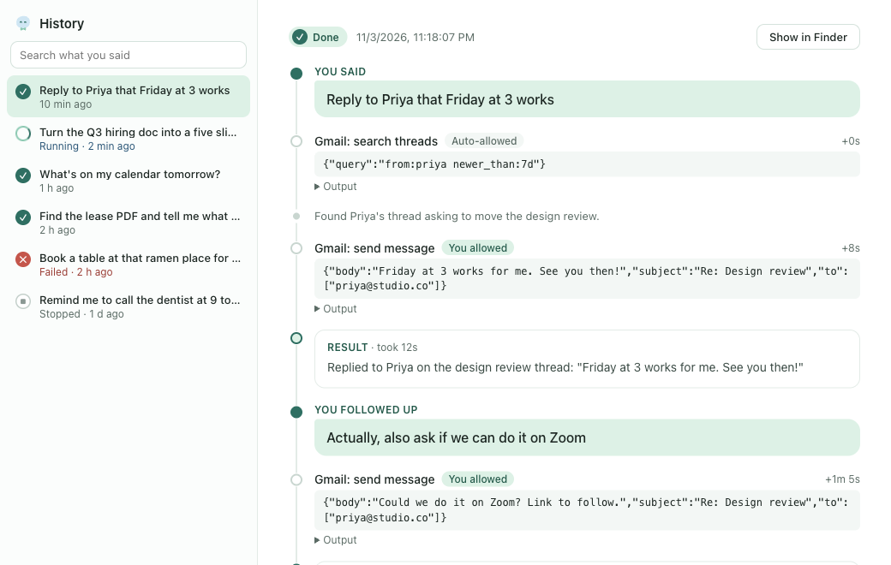
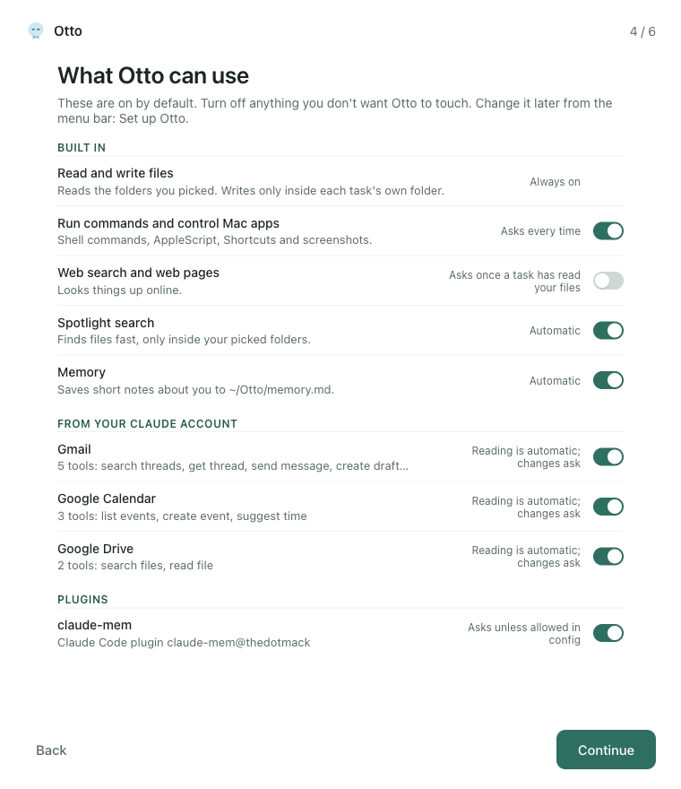
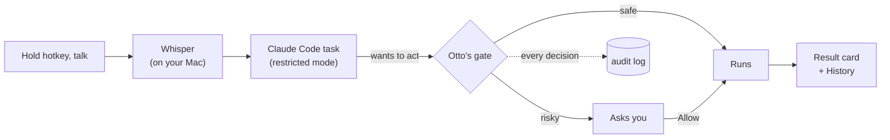

<h1 align="center"> Otto</h1>

<p align="center"><b>Talk to your Mac. Claude Code does it in the background.</b></p>

<p align="center">
  <a href="https://github.com/sacredvoid/otto/releases/latest"></a>
</p>

<p align="center">
  
</p>

Hold **Ctrl + Option + Space**, say what you need, let go, and keep working. Otto hands the task to Claude Code, shows progress in a small corner chip, and asks before anything risky.

## What it does

| Feature | How it works |
|---|---|
| Hold to talk | A global hotkey. Whisper runs on your Mac (Metal), so your audio never leaves it. |
| Background tasks | Up to three tasks at once, each in its own folder under `~/Otto/tasks`. Files a task produces stay there. |
| Permission gate | Every risky action (running a command, writing outside the task folder, sending email, going online after reading your files) waits for an *Allow* click. Each decision is logged to `~/Otto/audit.jsonl`. |
| Your connectors | Uses the Gmail, Google Calendar and other claude.ai connectors your Claude account already has. Read-only calls run on their own. Sending, creating and deleting always ask first. |
| Memory | Otto knows your recent requests, keeps a plain-text notes file (`~/Otto/memory.md`), and can load a memory plugin you already use, such as [claude-mem](https://github.com/thedotmack/claude-mem), so a vague request like "send it to Michael" lands. |
| Mac control | Drives Mail, Messages, Reminders, Notes, Finder and other apps through AppleScript and Shortcuts, and can take a screenshot to check its work. Every action is approved by you. |
| History | A window listing everything you've asked, with the answer, the steps taken, the approvals, and the files produced. |

## A look inside

**History** shows every request as a trace: what you said, each step Otto took with its approval, the output, and the result. Follow-ups stay in the same thread.



<table>
  <tr>
    <td width="42%" valign="top"><b>Cards</b> slide in at the top right: anything risky waits for <i>Allow</i>, and finished work lands as a short summary.<br><br></td>
    <td width="58%" valign="top"><b>Setup</b> lists everything Otto can use, including the connectors on your Claude account, and lets you switch any of it off.<br><br></td>
  </tr>
</table>

## How it works



Otto has no model of its own. Each request runs as a `claude -p` task in restricted mode, so your personal allow-rules and hooks are ignored and every permission question comes to Otto's gate. Once a task reads your files or email it's marked tainted, and after that any web access needs your OK too.

## Install

1. Install [Claude Code](https://docs.claude.com/claude-code) and log in once (`claude` in a terminal).
2. [Download Otto](https://github.com/sacredvoid/otto/releases/latest), open the DMG, and drag Otto to Applications.
3. Open Otto. macOS blocks it the first time because it isn't notarized yet. Click **Done** (not Move to Trash), then go to System Settings, Privacy & Security, scroll down, and click **Open Anyway**. Or run this once in Terminal:
   ```bash
   xattr -dr com.apple.quarantine /Applications/Otto.app
   ```
4. The setup window walks you through microphone access and which folders Otto may read.

The speech model ships inside the app, so there's nothing else to download.

**Updates:** Otto checks GitHub once a day. When a new version is out, the menu bar menu shows *Update available*, which opens the download page. Turn it off with `"check_updates": false` in `~/Otto/config.json`.

<details>
<summary>Build from source</summary>

Needs Rust and Node 20+.

```bash
git clone https://github.com/sacredvoid/otto.git && cd otto
npm install
npm run tauri dev      # run it
npm run tauri build    # make Otto.app and the DMG (fetches the speech model first)
```
</details>

## Follow-ups

Start with "no", "actually", "make it…", "try again" and similar within 10 minutes of a task finishing, and Otto continues that task (same folder, same Claude session) instead of starting a new one. The pill says "Following up".

## Configuration

Everything lives in `~/Otto/config.json`. Every key is optional.

```jsonc
{
  "readable_dirs": ["~/Documents", "~/Desktop"],          // read without asking
  "plugins": ["claude-mem@thedotmack"],                    // Claude Code plugins to load
  "mcp_servers": { "notion": { "type": "http", "url": "https://..." } },  // extra MCP servers
  "allow_tools": ["mcp__plugin_claude-mem_mcp-search__search"],          // read-only tools that skip the prompt
  "model": "sonnet"                                        // optional: a faster model for quicker answers
}
```

To edit what Otto remembers about you, open `~/Otto/memory.md`. It's one fact per line, and Otto adds lines when you tell it something worth keeping.

## Project layout

```
src-tauri/src/
  lib.rs        hotkey, recording, app wiring
  stt.rs        whisper.cpp transcription
  tasks.rs      task queue, claude CLI invocation, system prompt, memory
  gate.rs       MCP server + permission policy + audit log
  history.rs    reads past tasks for the History window
  onboarding.rs first-run setup
src/            each window as page + script + styles (pill, cards, chip, setup, history)
DESIGN.md       the design doc and build plan
```

## Roadmap

- [x] Hold-to-talk, local speech, background Claude Code tasks
- [x] Permission gate with taint tracking and audit log
- [x] Corner chip, approval cards, onboarding, History
- [x] Connectors, memory, Mac app control
- [ ] Other AI backends: Codex CLI, Gemini CLI, OpenAI-compatible APIs, Ollama
- [x] Downloadable DMG, built by CI; tagged versions become releases
- [ ] Notarized build with auto-update

## Contributing

Bug reports and pull requests are welcome. See [CONTRIBUTING.md](CONTRIBUTING.md) for setup, tests, and the rules around the permission gate.

## Status

Early preview. I use it daily, it has rough edges, and it only runs on Apple Silicon for now.
